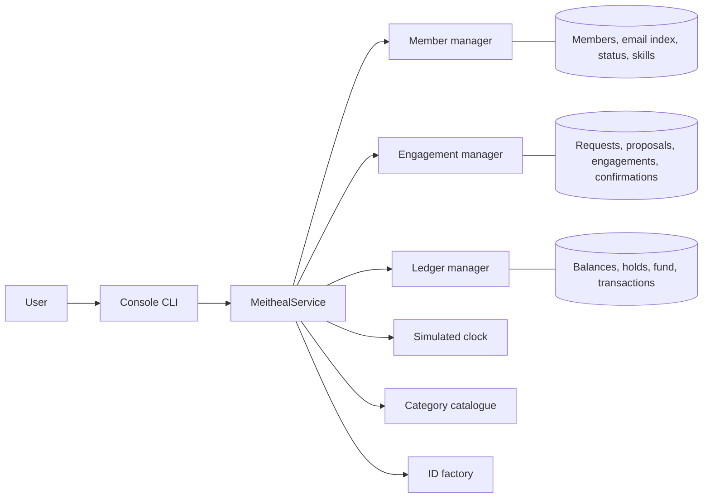

# Component architecture

[SharedContracts.md](SharedContracts.md) defines the behavior collaborators can rely on. [Invariants.md](Invariants.md) records what must hold and how to test it. This document explains why the components are split this way and which integration decisions still need team agreement.

## Dependency direction

The diagram shows the intended runtime wiring. The current baseline has Java interfaces and shared types. The concrete service, manager bindings, and runnable application still need integration.

Application startup constructs the concrete components and connects them through the shared interfaces. The CLI can be tested against a substitute service. A manager can be tested with controlled inputs and narrow dependencies while the other implementations are still in progress.

## Design decisions

| Decision | Why we chose it | Alternative considered |
| --- | --- | --- |
| The CLI calls `MeithealService` and renders its results. | The service provides one caller boundary for operations such as registration that involve more than one manager. The console handles parsing, selection of the active member, and rendering. | Let commands call managers directly. This would spread business validation and cross-manager coordination across the console. |
| Each manager owns its state and exposes typed IDs and immutable views. | Callers can refer to a member, request, or engagement without depending on another component's collections. Owners can change their internal representation while preserving the contract. | Share mutable records or collections. This would let callers bypass validation and make it harder to identify where an invariant is enforced. |
| The service coordinates cross-manager changes. The ledger manager owns every movement of credits. | Selection pairs an engagement with its hold. The second confirmation pairs completion with settlement. The payment and any levy belong to one ledger settlement. A failure must leave the related manager state unchanged. | Issue separate service calls for each change and then compensate if a later call fails. This exposes a risk of partial state and complicates retry. |
| Date-sensitive operations use a shared simulated date. | A workflow uses the same date for validation and ledgers, and tests can reproduce date boundaries without depending on the machine clock. | Let each component read the machine clock. A single command could observe different dates, and boundary tests would depend on wall time. |
| The catalogue is configured at startup and manager state is kept in memory. | Validation and matching work from a fixed list of categories. The CLI, managers, and service can be exercised without a database, authentication service, or background scheduler. | Let users add categories through a request or offer, or introduce persistent infrastructure before the core workflow is working. |

## Team decision before pairing managers

The success and failure behavior is agreed in [SharedContracts.md](SharedContracts.md#cross-owner-failure-contract). The Java manager interfaces do not yet define how each owner prepares and publishes a shared change.

Start by agreeing the registration boundary. Joe, Moaz, and Benjamin should settle what each owner prepares, when its checks can fail, how a stale preparation is detected, and how the service makes the member and welcome grant visible together. Prepare and validate both changes before publication. Agree the publication mechanism and prove it with a failure test before relying on it. Running two ordinary writes back to back would leave a member without a grant if the second write failed. Once registration works, apply the same reasoning to holds, settlement, cancellation, and suspension.

Two smaller handoffs also need agreement. Moaz and Matthew should confirm who supplies the fixed catalogue file and which category IDs tests and the CLI can rely on. Joe and Abdus should agree which service results the first registration and balance commands display. Keep concrete signatures in Java and use an owner-local test while the real collaborating component is being built.

## First independent slices

| Contributor | Can start against the current baseline | Pair up when |
| --- | --- | --- |
| Moaz | Canonical email lookup, member status and skills, immutable member queries, and tests for the membership boundary. | With Benjamin and Joe for registration and with Matthew and Joe for suspension and pending proposal cleanup. |
| Benjamin | Ledger balance and history, welcome-grant rules, and focused ledger tests. | With Moaz and Joe for the welcome grant at registration. With Matthew and Joe for holds and settlement. |
| Matthew | Request validation, matching and proposal behavior, with controlled member and catalogue inputs. | With Moaz on member and category eligibility and with Benjamin and Joe on selection, confirmation, and cancellation. |
| Abdus | CLI parsing, command dispatch, and rendering against a test implementation of `MeithealService`. | With Joe when the first real registration and balance commands are ready for a console test. |
| Joe | Shared build and contracts, simulated clock, application wiring, and the first integration test for registration. | With the relevant owners before changing any shared interface. After each paired slice, test success, failure, and retry against the real components. |

## Design patterns in the report

Record a pattern with the decision and code that demonstrate it. The service is a candidate for a Facade once it delegates real workflows to the managers. Record an Adapter if a wrapper actually translates an existing manager API into a shared interface. An interchangeable policy such as Strategy is useful only when the implementation has a real reason to choose between policies. The report can name the patterns used after the implementation exists.
