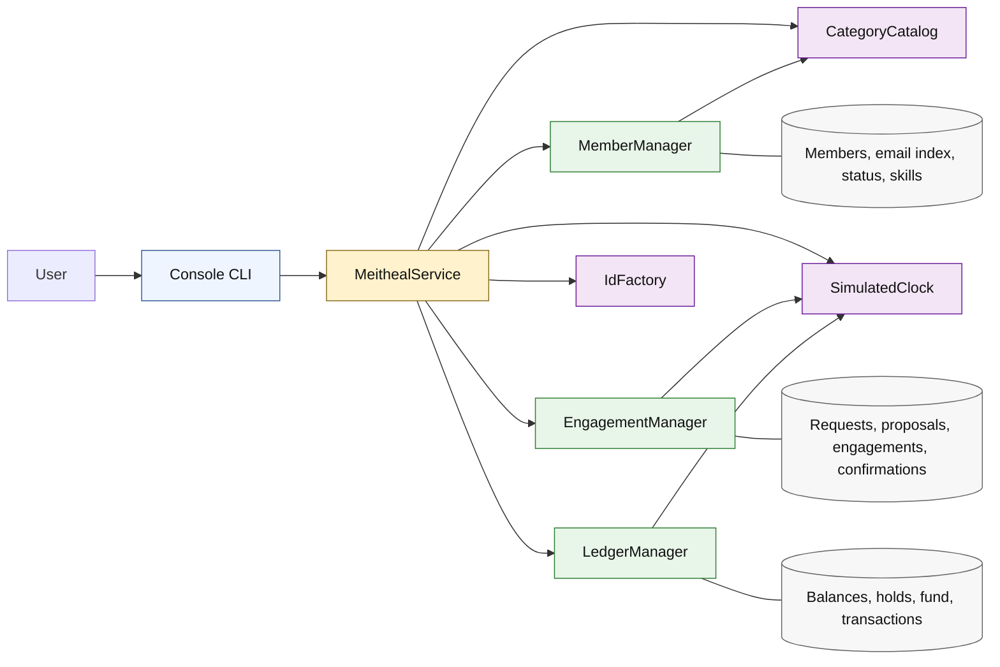

# Component architecture

This is the recommended single diagram for the design report. It shows ownership and dependency direction without implementation detail.



## Dependency rules

- The CLI depends on `MeithealService`, never on manager collections.
- The service coordinates operations crossing manager boundaries.
- Managers own state and return immutable views.
- The clock, catalog, and ID factory are injected dependencies.
- No component reads the machine clock.
- No manager reaches into another manager's collection.
- No database, network, authentication, or background scheduler component exists in core scope.

## Conservation equation

```text
member balance total + community fund balance
= approved initial external source + 120 * registered member count
```

The V2 policy sets the initial fund to zero, so the external-source term is zero. A non-zero seed requires a binding clarification and recorded amendment.
