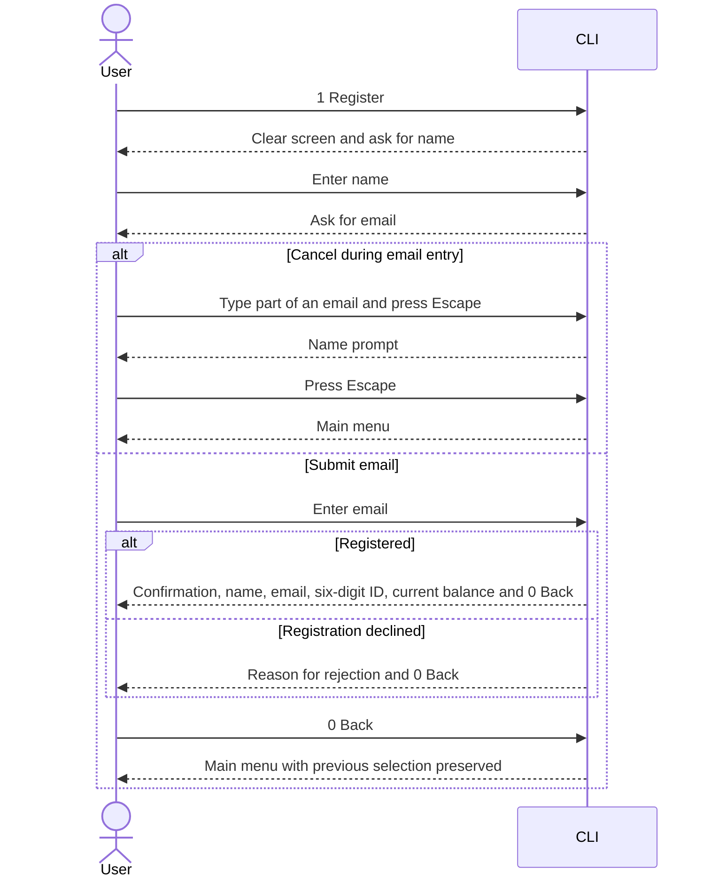
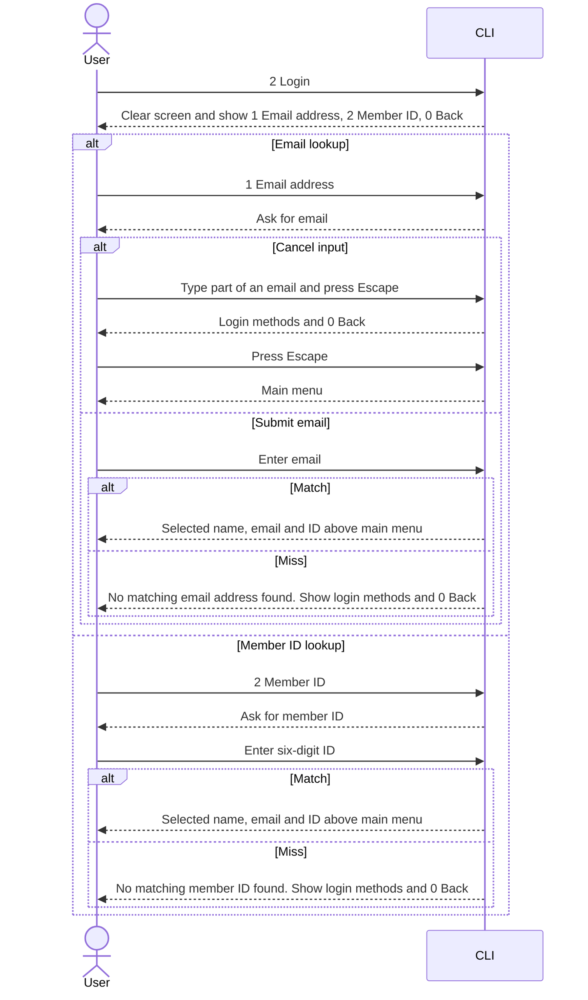
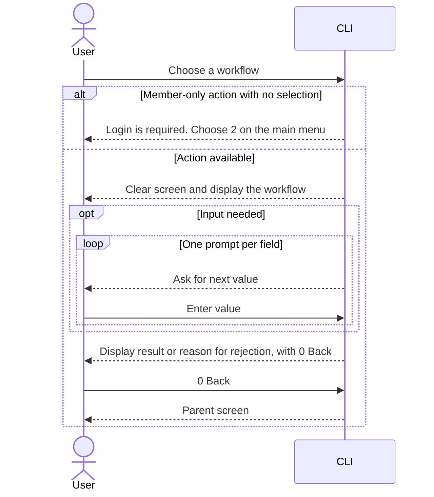

# Console menu and member selection

The group discussed the console features in person and used transcription software to capture the decisions. Abdus used those decisions to prepare the final diagrams with assistance from GPT-6.1 Sol.

## Main menu

Print the same choices on startup and after returning from a workflow. On startup, begin with the menu. When a member is selected, print their name, email and six-digit ID immediately above it. Choosing Login again lets the user switch members.

```text
 1  Register
 2  Login
 3  Publish a skill offer
 4  Raise a request
 5  Find matches and manage proposals
 6  Select a proposal
 7  Confirm a session
 8  Cancel an engagement
 9  Suspend or reinstate a member
10  Apply for a community grant
11  View balance and history
12  View report
13  View or advance simulated date
 0  Exit
```

The seven existing system sequences appear in their original order at 1, 5, 6, 7, 8, 9 and 10. Joe specified the first three choices. The placement of the remaining operations without a system sequence is proposed for review. [Core sequence flows](SequenceDiagrams.md)

Clear the screen on entry to each workflow or submenu. Ask for one value at a time. Display `0 Back` on every submenu. Only `0 Exit` on the main menu ends the program. Escape discards any partially typed value immediately and moves back one screen. Repeated presses walk back through successive screens.

### Registration

Choosing Register opens the name prompt directly. Registration preserves the current member selection. The confirmation displays the balance returned for the registered member.



### Login

Login selects a member without a password. Each method asks for its own lookup value. A successful lookup replaces any previous selection. A cancelled or unsuccessful lookup preserves it.



### Using the remaining choices



| Choice | Prompts and result |
| --- | --- |
| 3 | Choose a configured category. Publish the offer for the selected member. |
| 4 | Choose a category, then enter minutes, earliest date and latest date at separate prompts. Show the new request ID. |
| 5 | Show matching requests. To propose, choose a request and then enter a date. Also allow the helper to view or withdraw their proposals and the requester to inspect or reject proposals for their request. |
| 6 | Choose an owned request, then a pending proposal. Show the resulting engagement or the reason selection failed. |
| 7 | Choose an engagement to confirm. Show whether the other confirmation is still needed or the session has settled. |
| 8 | Choose an engagement to cancel. Show the cancellation result or the reason it could not be cancelled. |
| 9 | Choose Suspend or Reinstate, then enter the target member ID. |
| 10 | Enter a grant amount. Show approval or the reason for refusal. |
| 11 | Choose balance, ledger history or engagement history. For balance, label ledger, held and available credits. |
| 12 | Display the system report, including total credits and the community fund balance. |
| 13 | Show the simulated date. Offer an advance action with a separate date prompt. |

Choices 3-8, 10 and 11 reuse the selected member ID. Keep them visible when signed out. The proposed menu allows report, simulated date and changing a target member’s status without a selection, since those operations do not take an acting member ID. [Service interface](../../app/src/main/java/ie/ucd/meitheal/app/MeithealService.java)

## Example console session

Each bracketed menu below stands for the full list above. Bracketed keystrokes act before Enter. The example begins with an empty membership register.

```text
[Main menu, beginning with 1 Register]
> 3
Login is required to publish a skill offer. Choose 2 Login.
[Main menu]

> 1
[Clear screen]
Name: Alex Byrne
Email: alex@ [Escape]
Name: [Escape]
[Main menu]

> 2
[Clear screen]
1 Email address   2 Member ID   0 Back
> 1
Email: alex@ [Escape]
1 Email address   2 Member ID   0 Back
> [Escape]
[Main menu]

> 1
[Clear screen]
Name: Alex Byrne
Email: alex@example.org
Registration successful
Name: Alex Byrne   Email: alex@example.org
Member ID: 100001   Current balance: 120 credits
0 Back
> 0
[Main menu]

> 2
[Clear screen]
1 Email address   2 Member ID   0 Back
> 2
Member ID: 100002
No matching member ID found.
1 Email address   2 Member ID   0 Back
> 1
Email: alex@example.org
Alex Byrne | alex@example.org | 100001
[Main menu]
> 0
```

The current command loop reads complete lines. Detecting Escape while text is partly entered needs a terminal-input check during implementation. [CLI input loop](../../cli/src/main/java/ie/ucd/meitheal/cli/MeithealCli.java)
