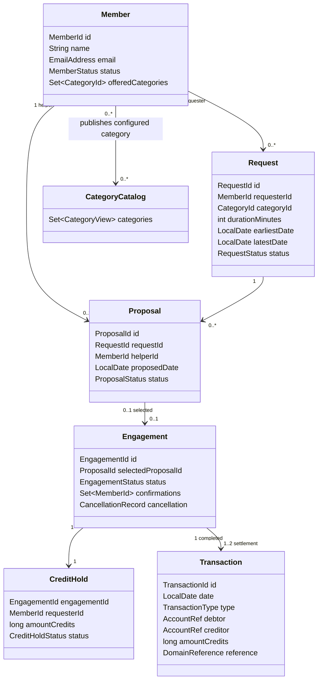
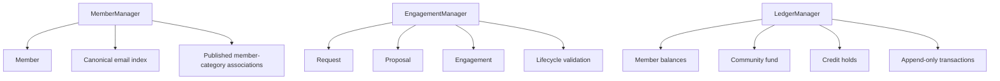

# Domain model and ownership

## Cardinality rules

- One member can publish many different categories.
- One member-category pair is unique.
- One request can receive many proposals.
- One helper has at most one pending proposal for one request.
- One request has at most one selected proposal.
- One selected proposal creates exactly one engagement.
- One engagement has exactly one hold keyed by engagement ID.
- One completed engagement has one service-payment transaction and, when levy is positive, one levy transaction with the same engagement reference.

## Normalization rules

- Relationships store typed IDs, not copied mutable entities.
- A proposal stores its request ID and helper ID.
- An engagement stores its selected proposal ID.
- Request details remain the authoritative category, duration, window, and requester.
- A hold is a financial lock, not a transaction.
- Transactions are immutable transfer facts and are never edited or deleted.

## Ownership diagram

