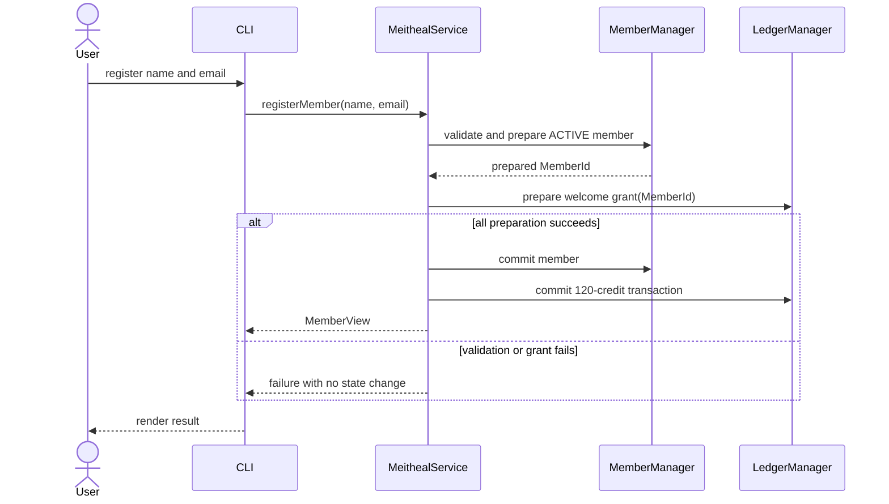
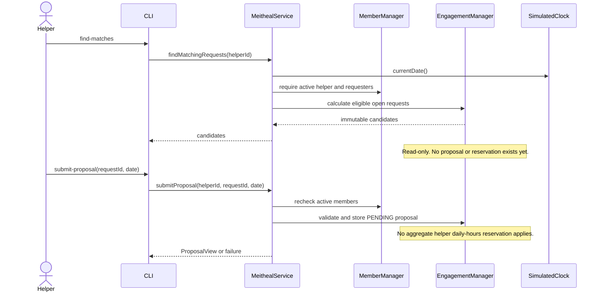
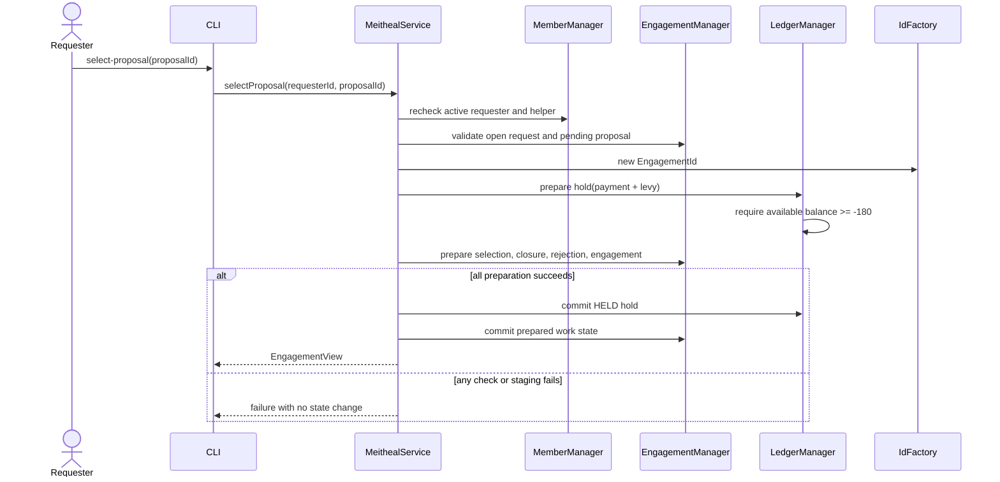
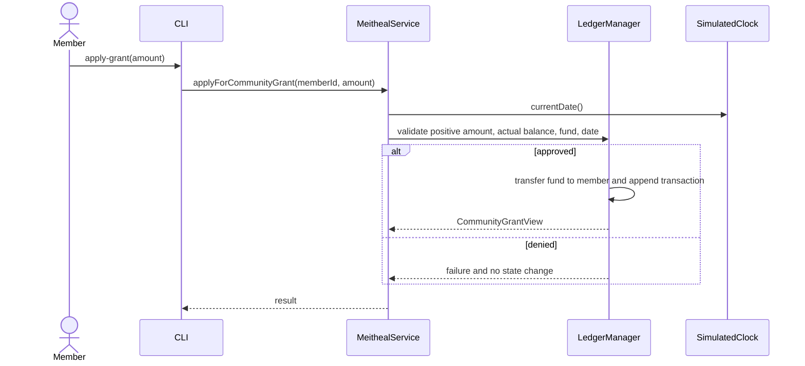

# Core sequence flows

## Registration and welcome grant



## Matching and proposal submission



## Proposal selection and agreement



## Two confirmations and settlement

```mermaid
sequenceDiagram
    actor Participant
    participant CLI
    participant Service as MeithealService
    participant Work as EngagementManager
    participant Ledger as LedgerManager
    participant Clock as SimulatedClock

    Participant->>CLI: confirm-completion(engagementId)
    CLI->>Service: confirmCompletion(engagementId, actorId)
    Service->>Clock: currentDate()
    Service->>Work: validate participant, date, state, duplicate
    alt first confirmation
        Service->>Work: record actor only
        Service-->>CLI: awaiting other participant
    else second confirmation
        Service->>Ledger: prepare settlement by engagement ID
        Ledger->>Ledger: prepare service payment and any positive levy transaction
        Service->>Work: prepare second confirmation and COMPLETED
        alt settlement preparation and commit succeed
            Service->>Ledger: commit prepared transactions and SETTLED hold
            Service->>Work: commit confirmation and COMPLETED
            Service-->>CLI: completed EngagementView
        else technical failure
            Service-->>CLI: ATOMIC_OPERATION_FAILED
            Note over Work,Ledger: No second confirmation, no transaction, hold remains HELD
        end
    end
```

## Cancellation

```mermaid
sequenceDiagram
    actor Participant
    participant CLI
    participant Service as MeithealService
    participant Work as EngagementManager
    participant Ledger as LedgerManager
    participant Clock as SimulatedClock

    Participant->>CLI: cancel-engagement(engagementId)
    CLI->>Service: cancelEngagement(engagementId, actorId)
    Service->>Clock: currentDate()
    Service->>Work: validate participant, AGREED, today before date
    Service->>Ledger: prepare hold release
    Service->>Work: prepare cancellation record and state change
    alt valid and all preparation succeeds
        Service->>Ledger: commit RELEASED hold
        Service->>Work: commit CANCELLED and cancellation record
        Service-->>CLI: cancelled EngagementView
    else invalid or technical failure
        Service-->>CLI: failure with no state change
    end
```

## Community grant


