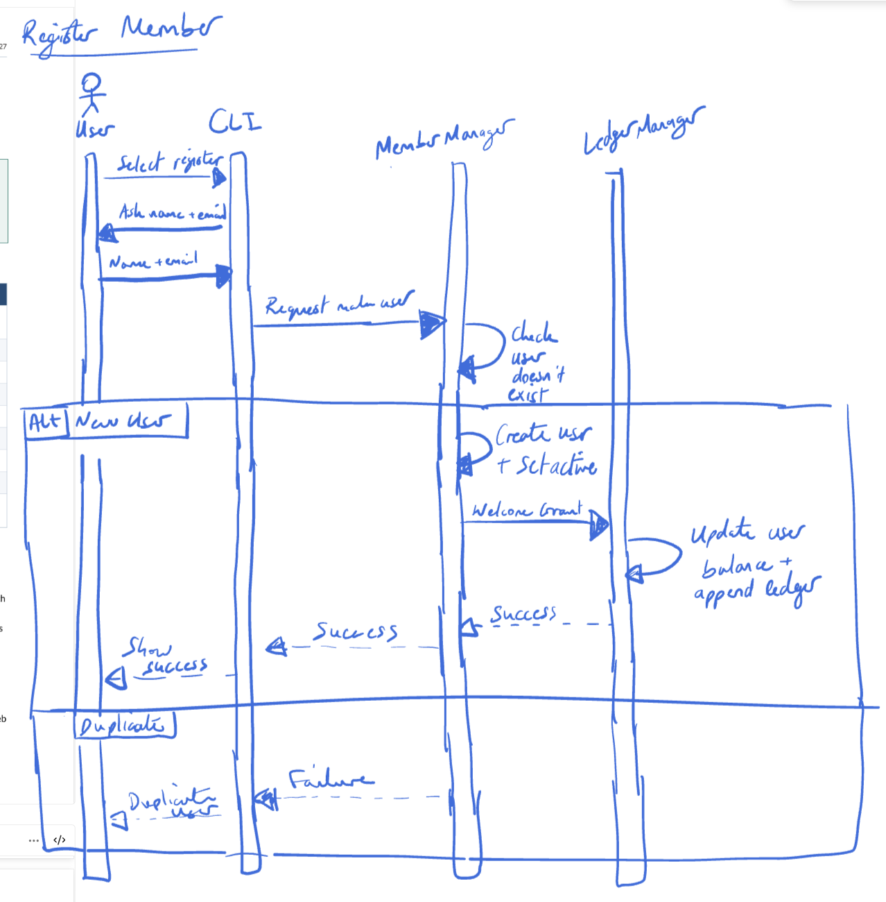
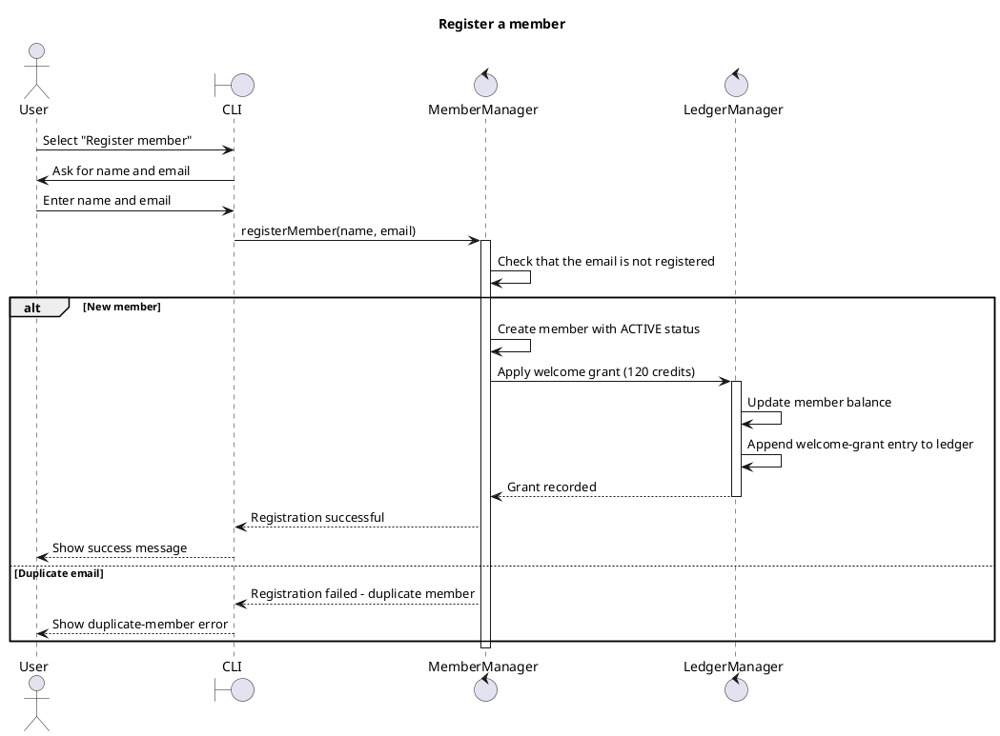
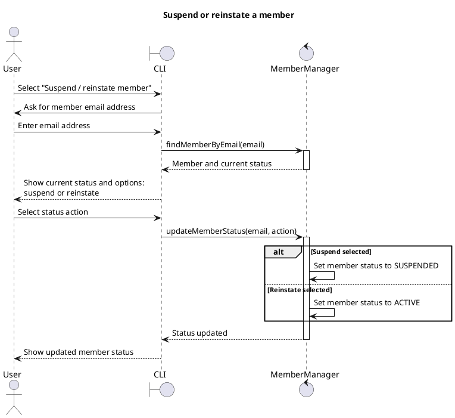
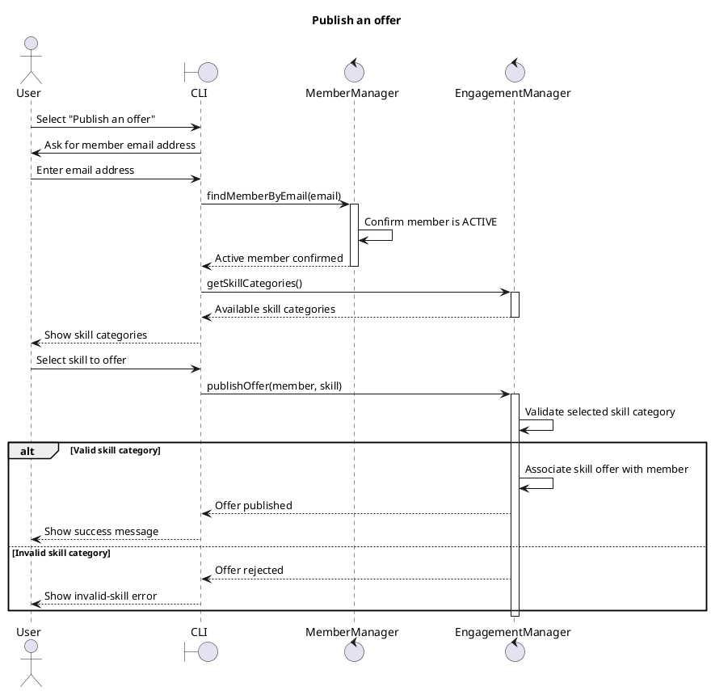
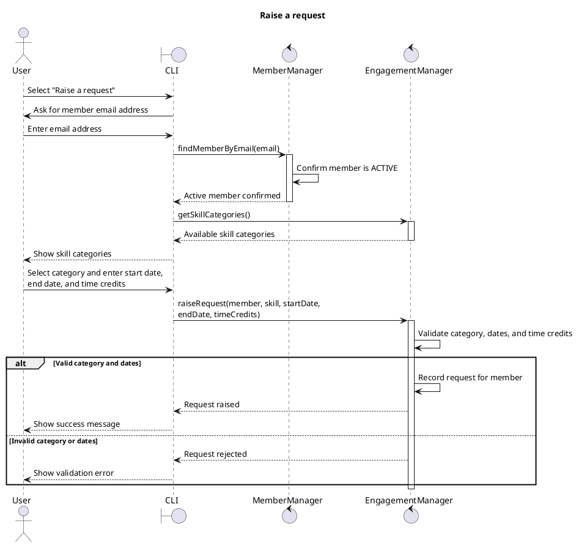
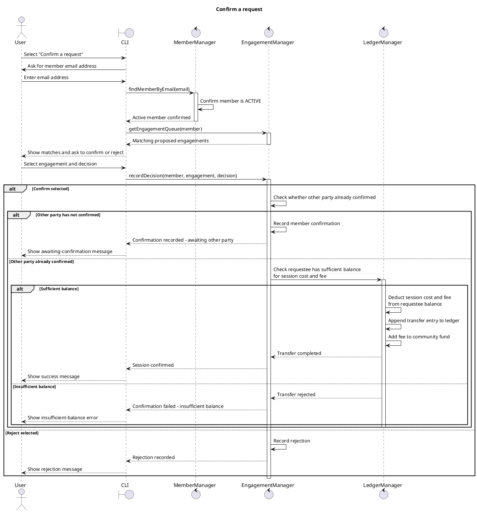
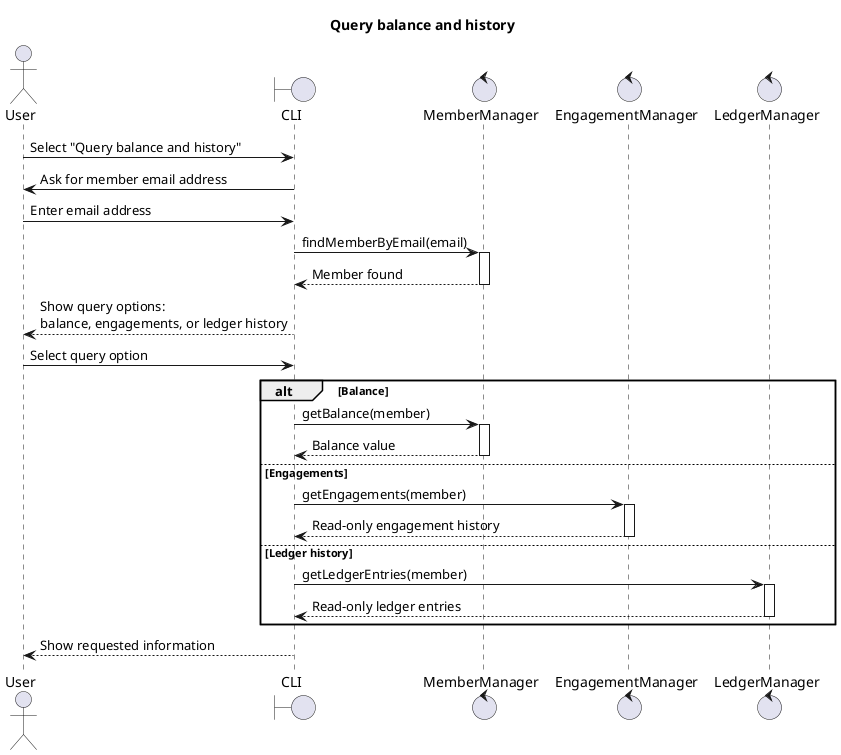
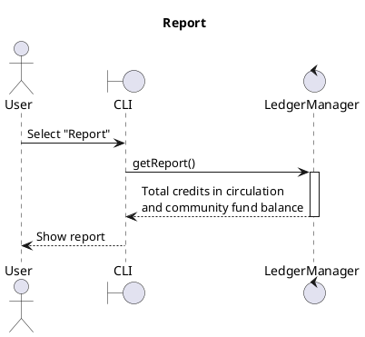

# Sequence diagrams

Each sequence was discussed as a team in a meeting, then sketched and hand-drawn. The register-member sketch below is one example.

ChatGPT was then used to convert the sketches into PlantUML code, producing cleaner rendered diagrams and preserving them as documentation.

All diagrams were verified by the team for quality. They communicate the intended design and interactions, rather than exact function calls or implementation details.

## Register a member

## Suspend or reinstate a member

## Publish an offer

## Raise a request

## Propose an engagement

No sequence diagram is needed. Engagement proposals are created automatically inside `EngagementManager`; they do not involve a user action or CLI interaction.

## Confirm a request

## Cancel an engagement

**Not complete - specification decision required.** R4 transfers credits when both parties confirm a session, but R14 says that cancelling a confirmed engagement less than 24 hours before its agreed start transfers no credits. At cancellation time, credits may already have transferred. The team must decide whether a refund or compensating ledger entry is permitted before a sequence diagram can be finalised.

## Apply for a community grant

**Not complete - specification decision required.** The brief does not define whether a community grant is approved automatically, by a member, or by another user type. It also does not define how the grant amount is chosen. The team must decide these points before a sequence diagram can be finalised.

## Query balance and history

## Report

