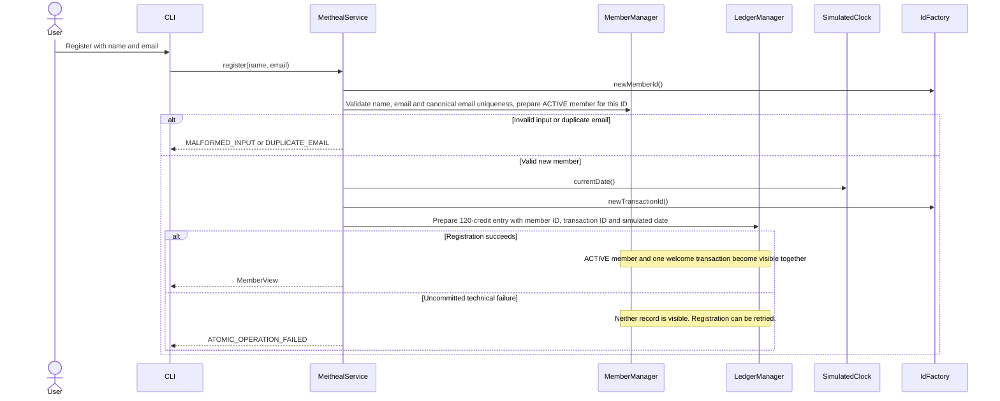
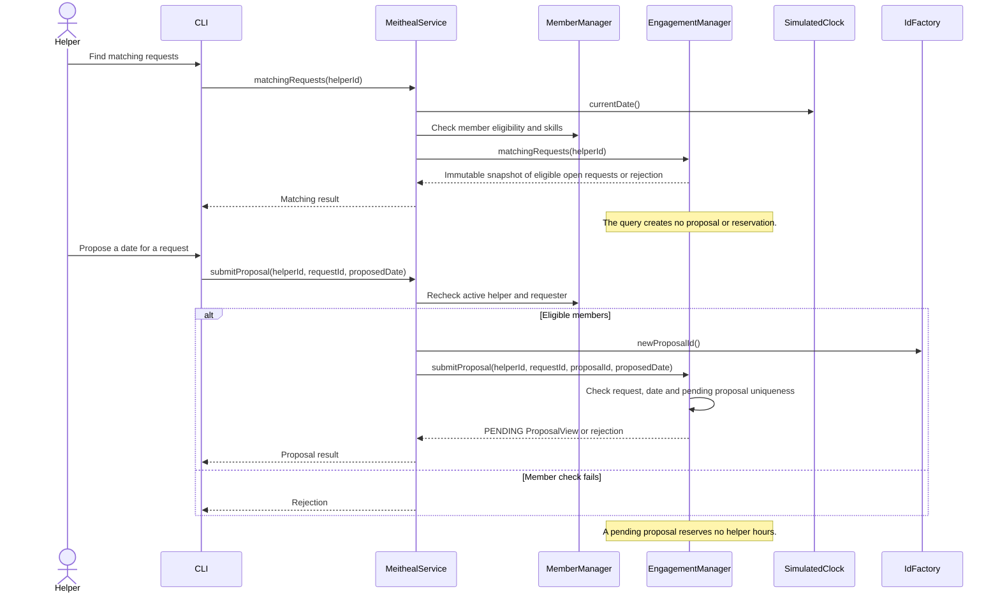
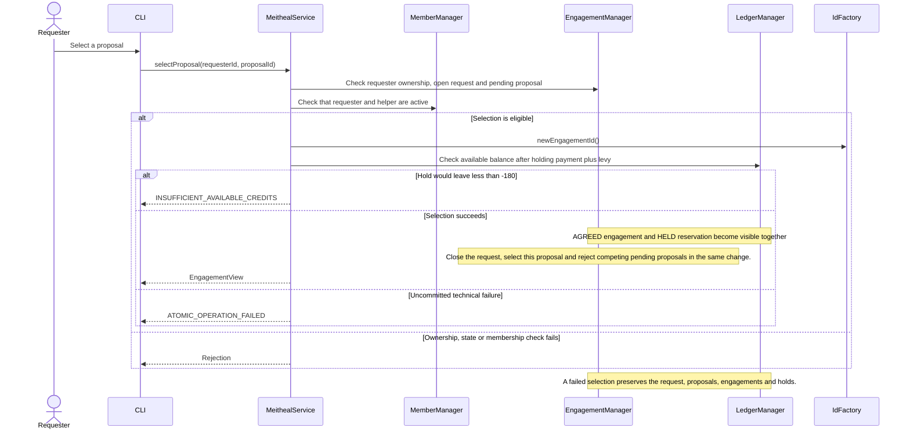
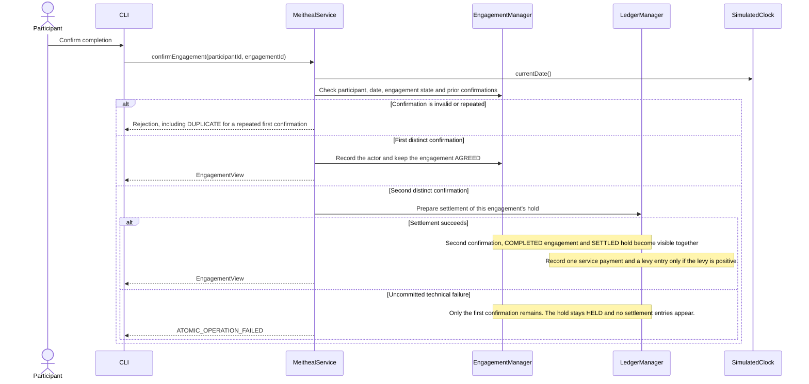
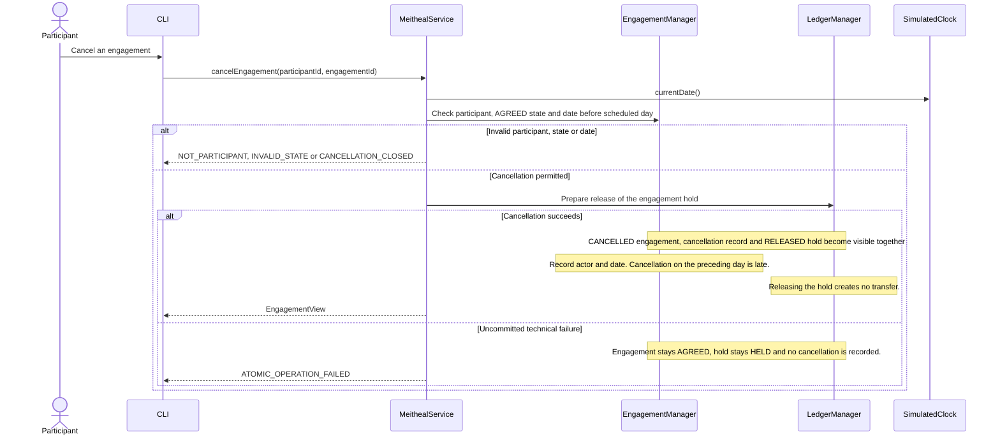
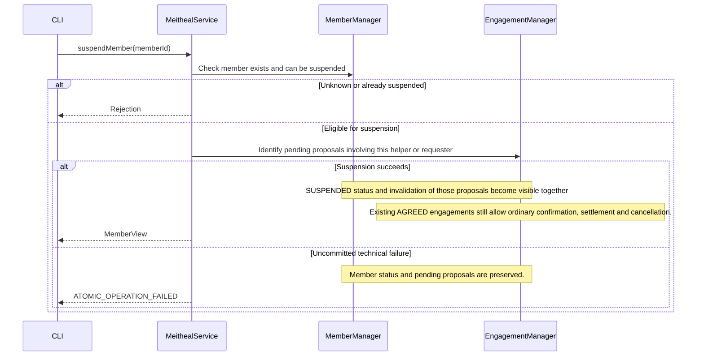
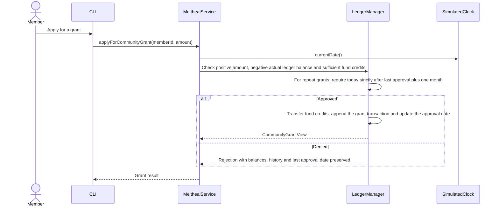

# Core sequence flows

These diagrams describe the intended workflows. CLI-to-service calls use the names and argument order in [MeithealService.java](../../app/src/main/java/ie/ucd/meitheal/app/MeithealService.java). Actions entered by users describe intent. Manager messages describe each owner's responsibility. A note spanning two owners shows the outcome that callers must observe together. The service holds one lock while the managers prepare both changes and make them visible together. [Shared caller contracts](SharedContracts.md) and [architecture decisions](Architecture.md#how-managers-make-a-change-together)

## Registration and welcome grant

## Matching and proposal submission

## Proposal selection and agreement

## Two confirmations and settlement

## Cancellation

## Suspension and pending proposals

## Community grant

