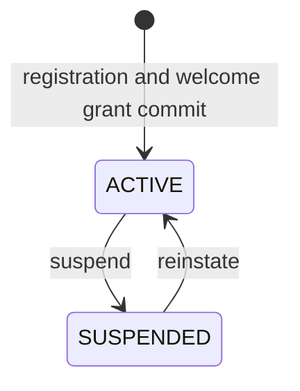
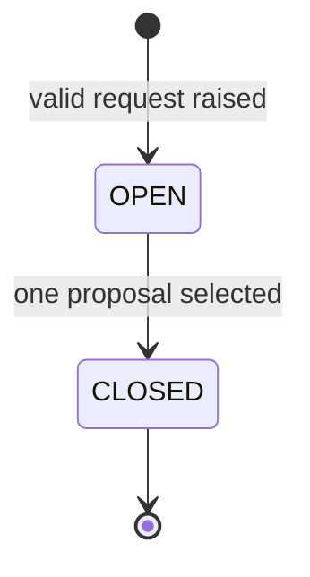
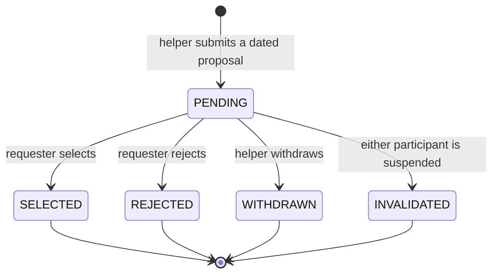
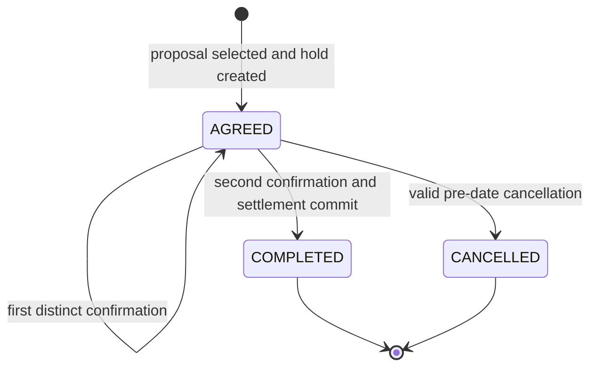
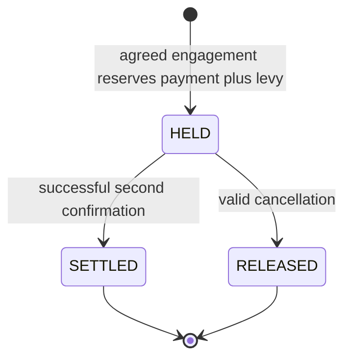
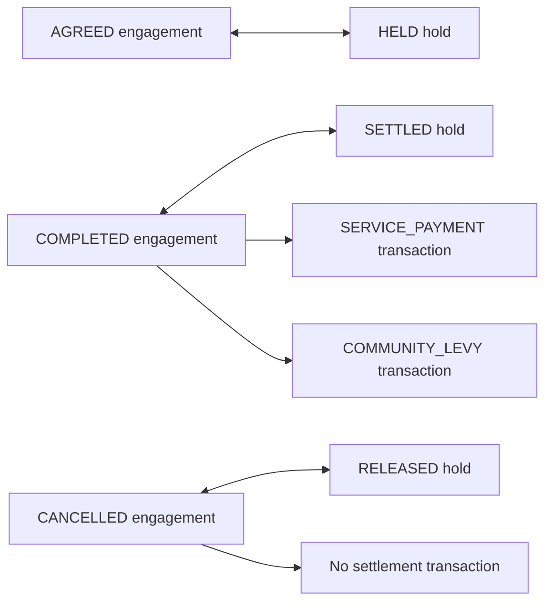

# State machines

## Member

Suspension prevents new work and invalidates pending proposals involving the member. It does not cancel an agreed engagement or prevent valid completion and settlement.

## Request

Request terms are immutable after creation. A changed category, duration, or window requires a new request.

## Proposal

`PENDING` has no time-capacity reservation. A helper may have work exceeding 480 total minutes on a date, provided each individual engagement remains within the R8 duration bound.

## Engagement

A failed second-confirmation settlement leaves the engagement `AGREED`, retains only the first confirmation, and leaves the hold `HELD`.

## Credit hold

`HELD` changes available balance but not ledger balance. `RELEASED` creates no transaction. `SETTLED` corresponds to one service-payment transaction and one levy transaction when the levy is positive.

## State equivalence

